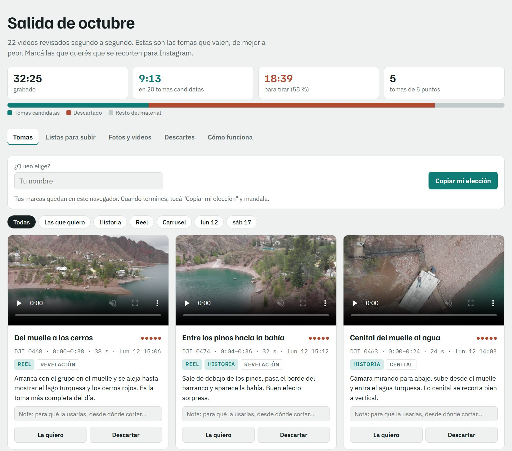
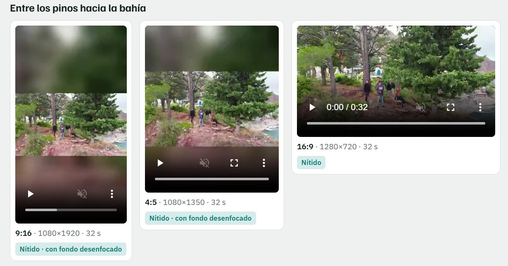

# Post-vuelo

Una skill de [Claude Code](https://claude.com/claude-code) para lo que pasa después de volar un
dron DJI: bajar la tarjeta, revisar horas de video, quedarse con las tomas que valen y tenerlas
listas para Instagram.

*A Claude Code skill for DJI drone footage: offload the card, analyze every clip, let anyone pick
the best shots on a shareable page, and export sharp 9:16, 4:5 and 16:9 cuts for Instagram.
Spanish-first; Claude answers in your language.*



## Qué hace

1. **Bajar**: copia la tarjeta a la carpeta que elijas (por ejemplo Google Drive), separada por
   salida y con nombre de lugar, verificando cada archivo. Nunca borra la tarjeta.
2. **Analizar**: mide cada segundo de cada video (movimiento, nitidez, brillo), detecta los
   tramos con el dron en el piso y arma hojas de contacto. Claude las mira y elige las tomas:
   revelaciones, cenitales, paisajes, con puntaje y para qué formato sirve cada una.
3. **Elegir**: genera una página con una vista previa de cada toma. Quien la abre marca "La quiero"
   o "Descartar". Publicada como artifact de Claude, las marcas se guardan solas; en cualquier
   otro hosting, cada uno toca "Copiar mi elección" y la manda por WhatsApp.
4. **Recortar**: hace 9:16 (1080×1920), 4:5 (1080×1350) y 16:9 a la resolución original, con
   color corregido para D-Cinelike, encuadre o paneo por toma, y sin metadatos.
5. **Entregar**: los cortes quedan en la carpeta de la salida y la página muestra cuáles están
   nítidos y cuáles son borrador porque el original no tenía resolución.

Con `--sin-ubicacion`, la página sale sin mapa, sin coordenadas y sin el nombre del lugar,
para compartirla con gente de afuera.

## Un ejemplo real

Dos salidas de octubre con un Mavic Air 2, 22 videos y 32 minutos de grabación:

- **Análisis:** 9 minutos quedaron en 20 tomas candidatas y 18 minutos (58 %) fueron para tirar.
  El grueso eran 13 minutos con la cámara grabando en el piso después de aterrizar.
- **Elección:** la página se compartió y se eligieron 13 tomas.
- **Cortes:** salieron 39 archivos, cada toma en 9:16, 4:5 y 16:9. Los videos estaban en 720p,
  así que los verticales se armaron "con relleno": el cuadro entero y nítido al centro, y el
  mismo video desenfocado arriba y abajo, en lugar de estirar una franja angosta hasta que se pixele.



## Requisitos

- Claude Code
- Python 3.10 o más nuevo, con `pip install pillow numpy`
- [ffmpeg](https://ffmpeg.org/download.html) (`ffmpeg` y `ffprobe` en el PATH)

## Instalación

Como plugin:

```
/plugin marketplace add ernestokern/post-vuelo
/plugin install post-vuelo@post-vuelo
```

O copiando la carpeta `skills/post-vuelo` a `~/.claude/skills/post-vuelo`.

## Uso

Conectá la tarjeta y decile a Claude **"volví de volar"**. La primera vez te pregunta dónde
guardar las salidas y crea `~/.post-vuelo.json` (ver `skills/post-vuelo/config.ejemplo.json`).
También sirve entrar por la mitad: "analizá los videos de la salida del sábado", "armá la página
para elegir", "leé lo que eligieron", "recortá las que elegí".

Para cortes verticales nítidos hay que grabar en 4K. `skills/post-vuelo/referencia/ajustes.md`
explica cómo configurar el dron y por qué.

## Licencia

MIT
